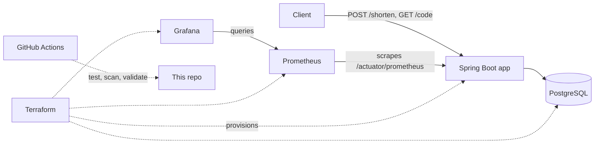
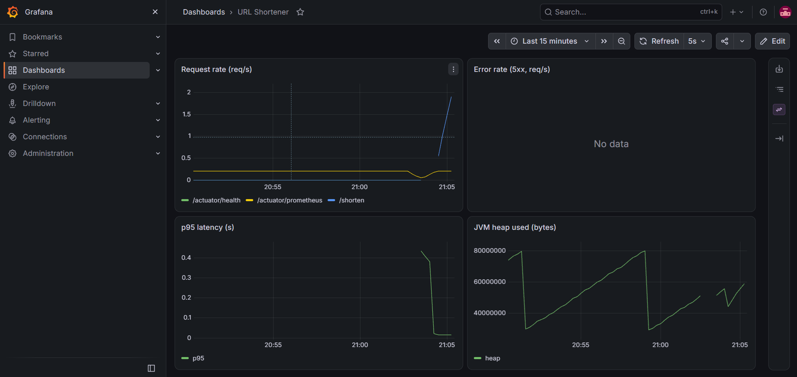
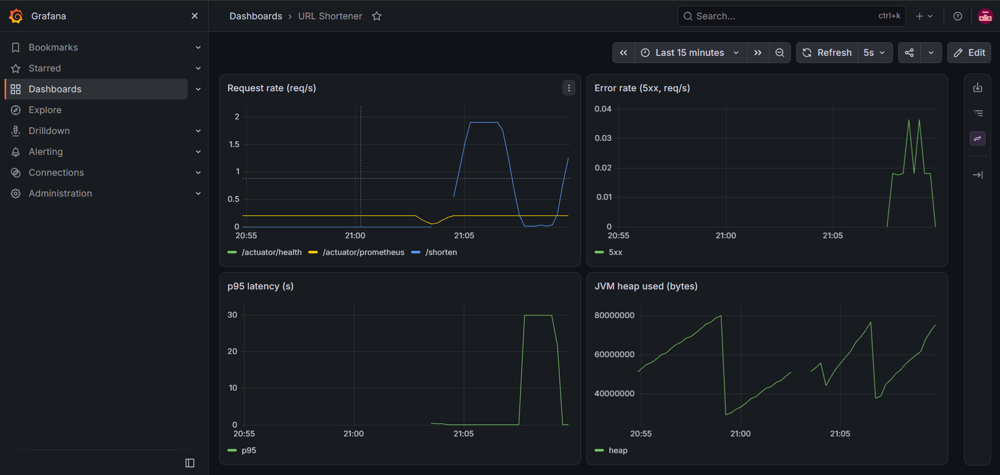

# devops-showcase

A small URL shortener used as a vehicle to demonstrate the DevOps lifecycle end to end: containerization, CI with security scanning, infrastructure as code, and monitoring with dashboards.

The application is deliberately simple. The focus of this repository is everything around it.

## Architecture



| Component | Technology |
|---|---|
| Application | Java 21, Spring Boot 4, Spring Data JPA, Micrometer |
| Database | PostgreSQL 16 |
| Container image | Multi-stage Dockerfile, non-root runtime user |
| CI | GitHub Actions: tests against a real Postgres, Trivy image scan, Terraform format and validate |
| Infrastructure as code | Terraform with the Docker provider |
| Monitoring | Prometheus and Grafana, dashboard provisioned from files |

## API

| Method | Path | Description |
|---|---|---|
| POST | `/shorten` | Body `{"url": "https://example.com"}`, returns `201` with a code and short URL |
| GET | `/{code}` | `302` redirect to the original URL, `404` if unknown |
| GET | `/actuator/health` | Health check |
| GET | `/actuator/prometheus` | Metrics in Prometheus format |

Input is validated: only `http://` and `https://` URLs are accepted, anything else returns `400`.

## Run it

Requirements: Docker Desktop and Terraform.

```bash
cd infra
terraform init
terraform apply
```

| Service | URL |
|---|---|
| App | http://localhost:8080 |
| Prometheus | http://localhost:9090 |
| Grafana | http://localhost:3000 (dashboard: **URL Shortener**) |

Try it:

```bash
curl -X POST http://localhost:8080/shorten \
  -H "Content-Type: application/json" \
  -d '{"url":"https://github.com"}'
```

Tear everything down with `terraform destroy`.

A plain `docker-compose.yml` is also included for quick local runs (`docker compose up -d --build`). In that setup Postgres is exposed on host port 5433, because 5432 is often taken by a local Postgres install.

## CI pipeline

Every pull request and every push to `develop` runs three jobs:

1. **build-test**: runs the test suite against a real PostgreSQL service container.
2. **docker**: builds the image and scans it with Trivy. HIGH and CRITICAL findings with an available fix fail the build.
3. **terraform**: `terraform fmt -check` and `terraform validate`.

Changes reach `develop` through pull requests only.

## Monitoring

The Grafana dashboard is provisioned from files in `monitoring/`, so it exists as soon as the stack starts. It shows request rate per endpoint, 5xx error rate, p95 latency and JVM heap usage.

### Healthy



Steady traffic: no 5xx errors, low p95 latency, normal JVM heap.

### During a database outage



The database was stopped for 40 seconds. Error rate spikes, p95 latency climbs to the 30 s connection-pool timeout, and request rate recovers once the database is back.

### Failure demo

1. Open the Grafana dashboard and the Prometheus targets page (`/targets`).
2. Generate traffic:
   ```powershell
   1..50 | ForEach-Object { Invoke-RestMethod -Method Post -Uri http://localhost:8080/shorten -ContentType "application/json" -Body '{"url":"https://github.com"}' | Out-Null }
   ```
3. Break it on purpose:
   ```bash
   docker stop shortener-app
   ```
4. Within a few seconds the `shortener` target goes **DOWN** in Prometheus and the dashboard stops receiving data.
5. Recover:
   ```bash
   docker start shortener-app
   ```
   The target returns to **UP** and the dashboard resumes.

## Design decisions and trade-offs

- **Terraform targets local Docker, not a cloud.** I wanted a real cloud deployment, but the free tiers I looked at all require a payment card, and I chose not to use one. The Docker provider keeps the full Terraform workflow (plan, apply, destroy, locked provider versions). Deploying to a cloud would mean swapping the provider and adding networking resources, while the rest of the repository stays the same.
- **Simple application on purpose.** Time went into the pipeline, scanning and monitoring rather than features.
- **Configuration through environment variables** (database URL, credentials, public base URL), so the same image runs unchanged in every environment.

## Known shortcuts

- Default credentials (`admin`/`admin` for Grafana, `shortener` for the database) are for local use only. In a real deployment they would come from a secrets manager.
- Terraform state is local. A real setup would use a remote backend with locking.
- No deployment job in the pipeline, since there is no remote target.

## Repository layout

```
app/                 Spring Boot application and Dockerfile
infra/               Terraform configuration
monitoring/          Prometheus config and Grafana provisioning
.github/workflows/   CI pipeline
docker-compose.yml   Quick local run
```